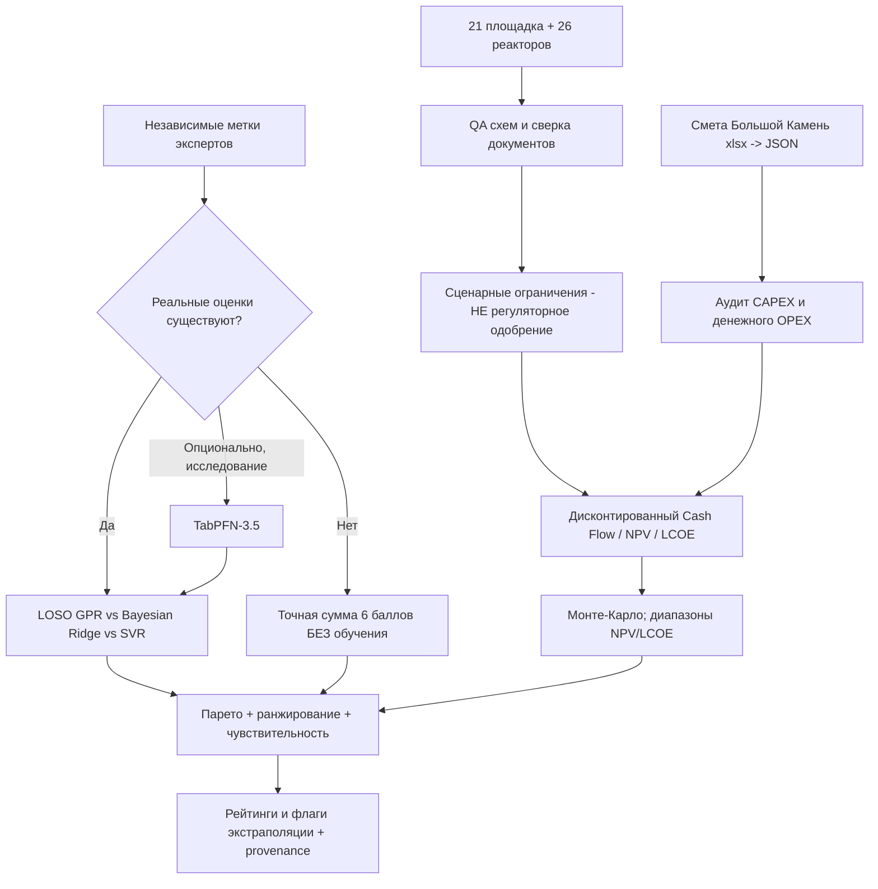

# ВОСТОК-612 — техническая ревизия ML-пайплайна и рекомендации к статье

**Дата:** 15 ноября 2026. **Версия:** 4.0.  
**База ревизии:** `nuclear_ml_pipeline(1).zip`, `research_article(1).md` (11.11.2026), `Тезисы AtomFuture.docx`, `КОНГРЕСС ОЩИЙ ДОКУМЕНТ.docx`, `Большой камень вся экономика.xlsx`.

> **Назначение:** программное исследование ранних энергетических альтернатив. Автоматическое ранжирование здесь НЕ является оценкой пригодности площадки, лицензирования, безопасности или доказательством экономической реализуемости.

## 1. Критические выводы аудита

### 1.1. Совпадение метки с входными признаками

`sites.csv`: 21 площадка, шесть оценок `[deficit, oyat, logistics, industry, economy, geo_climate]`. Для каждой площадки `expert_score` **точно равен сумме шести оценок**. Поэтому supervised-модель, предсказывающая `expert_score`, не изучает экспертные решения. В финальном программном проекте GPR остаётся недействующим до появления **действительно независимых** меток. Синтетические метки в модульных тестах не являются результатом исследования.

### 1.2. Методики для площадок несовместимы

- `Тезисы AtomFuture.docx`, абзац «Выполнена многокритериальная оценка»: заявлены **17 площадок, 9 параметров, лучший результат 25 из 27**.
- `КОНГРЕСС ОЩИЙ ДОКУМЕНТ.docx`, раздел 3.3: текст также описывает **17 площадок**.
- Реальный `sites.csv`: **21 площадка, 6 критериев по шкале 1..5, максимум 30**; у Большого Камня 25/30.

Код не смешивает разные версии критериев. Для использования девяти критериев нужен отдельный, оформленный источниками датасет и новая версия схемы. Нельзя объявлять оценку 25/30 эквивалентом 25/27.

### 1.3. Изучена новая финансовая модель

В листе `Лист1` нового Excel обнаружено:

| Статья | Млрд ₽ | Ячейки XLSX | Интерпретация |
|---|---:|---|---|
| CAPEX (сумма семи статей) | 77,00 | C3:C10 | оценка единственного пилотного блока СВБР-100, Большой Камень |
| OPEX, «валовый» | 5,18 в год | H3:H8 | включает амортизацию |
| Амортизация | 1,28 в год | H5 | **неденежная статья** при расчёте NPV, где CAPEX уже учитывается |
| Денежный OPEX | **3,90 в год** | расчёт 5,18 − 1,28 | для модели денежных потоков без двойного счёта капитала |

В валовом OPEX отдельно отражены 0,8 млрд ₽/год топливный цикл, 2,0 персонал, 0,6 страхование и налоги, 0,5 фонд вывода из эксплуатации; достоверность этих сумм и полная достаточность резервов остаются неподтверждёнными.

**Дополнительные флаги:**

- `Лист1!A5` называет «порт Корсаков», но описание `B5` и проект относятся к Большому Камню: географическая несогласованность затрат.
- Тезисы предполагают **60 лет** и КИУМ **80–85%**; `reactors.csv` для СВБР-100 содержит **50 лет**; общий документ в §4.2 использует **90% КИУМ**. Для базового расчёта сохраняется срок из каталога, 60 лет вынесены в what-if.
- В общем документе названо **500–800 МВт регионального дефицита** Приморья. Это не подтверждает среднюю нагрузку, тариф или договор поставки конкретному потребителю. Файл `scenario_demo.csv` (например, 250 МВт для Большого Камня) остаётся иллюстративным.

Стоимость 77 млрд ₽ **не является обучающим набором из 26 разных реакторов**. Прежняя степенная экстраполяция по мощности и количеству модулей сохранена в исследовательских what-if, но каждый перенос на иной объект теперь отмечен `UNVALIDATED_TRANSFER_FROM_SINGLE_BIGSTONE_CASE`.

## 2. Архитектура v4



**Отличия от v3:**

1. Автоматическая сверка финансовых итогов: `python -m nuclear_dss source-audit` и `scripts/import_economics_workbook.py` (если оригинальный XLSX доступен в окружении).
2. Переключение `--cost-profile bigstone_2026|legacy_2026`, полная фиксация источников в `report.json`, статусы переносимости стоимостей в каждой строке `ranking.csv`.
3. Поддержка `--operation-life-override 60` как явного what-if, а не тайного изменения срока службы каталога.
4. Дополнительные квартильные выходы для LCOE, пороговая цена NPV=0 (`breakeven_tariff_rub_kwh`).
5. Экспериментальный `compare-models`: тот же Leave-One-Site-Out для всех алгоритмов + bootstrap разностей MAE по площадкам. Тесты моделей запускаются **только после ввода независимых меток**.

## 3. Эксперименты на поставленных данных

Параметры: 21 площадка × 26 проектов × 1–3 модуля, `scenario_demo.csv`, семя 42, по 250 Monte-Carlo-сценариев на рассмотренную конфигурацию; GPR **не обучалась**, поскольку отсутствуют независимые метки.

| Показатель | Старый профиль `legacy_2026` | Новый профиль `bigstone_2026` |
|---|---:|---:|
| Рассмотрено исходных конфигураций | 1638 | 1638 |
| Прошли **числовые** фильтры (не лицензирование!) | 276 | 276 |
| Отклонено числами | 1362 | 1362 |
| Недоминируемые альтернативы | 9 | 5 |
| Положительный расчётный NPV | 0 | 8 |
| Лучший расчётный NPV, млрд ₽ | −23,06 | +8,01 |
| Случаи с неподтверждённой финансовой экстраполяцией | изначально сценарная модель | **276 из 276** |

**Научно важная интерпретация:** восемь положительных NPV в новом режиме НЕ доказывают конкурентоспособность и не означают, что новая модель предсказывает экономику лучше старой. Они возникают потому, что оценка стоимости одного модуля СВБР-100 из Большого Камня механически перенесена на совсем другие технологии/мощности/площадки (например, LFR-AS-200). Это **эксперимент на предположении**, а не верифицированный финансовый результат. Профиль 2026 корректно показывает эту неопределённость в каждом выходном CSV/JSON.

### Фокусная оценка одного пилотного блока

Для сочетания 100 МВт × 1 блок, локального **гипотетического** спроса 100 МВт, среднегодового коэффициента спроса 0,70, тарифа 15 ₽/кВт·ч, КИУМ 0,85, 5 лет строительства и ставки дисконтирования 9%:

| Сценарий | Денежный OPEX | Горизонт эксплуатации | NPV, млрд ₽ | LCOE, ₽/кВт·ч |
|---|---:|---:|---:|---:|
| старый финансовый якорь | 6,75 | 40 лет (исходный лимит) | −60,63 | 27,97 |
| новая смета | 3,90 | 50 лет (срок по каталогу) | **−24,15** | **20,07** |
| новая смета, what-if 60 лет | 3,90 | 60 лет | **−23,83** | **19,96** |

Эти расчёты демонстрируют чувствительность; они не доказывают, что LCOE по проекту равен этим числам. В новых тезисах заявлено 12–15 ₽/кВт·ч, но параметры соответствующего расчёта не полностью совпадают с приведёнными здесь. Для научной сопоставимости нужно согласовать денежный OPEX, КИУМ, фактическую реализуемую электроэнергию, ставку дисконтирования и инвестиционный график.

## 4. Какая ML-модель действительно лучше для исследования?

### Рекомендация на текущем объёме данных

**Сохранить GPR как обучаемый основной кандидат, а BayesianRidge — как консервативный baseline; сравнить с TabPFN-3.5 только после сбора независимых меток.** Для 21 объекта нет оснований полагать, что нейросеть автоматически лучше метода с регуляризацией и прозрачной неопределённостью.

| Подход | Зачем применять | Ограничения |
|---|---|---|
| Детерминированная рубрика | Отправная точка без обучения | Не самостоятельное ML-исследование |
| `GaussianProcessRegressor` / Matérn | Малые данные, явная модельная σ | Интервалы без внешней калибровки; kernel assumptions |
| `BayesianRidge` | Простая регуляризация и устойчивость на 21 наблюдении | Может пропустить нелинейность; нужно сравнение |
| `SVR` / RBF | Проверить нелинейную альтернативу | Выбор гиперпараметров на 21 объекте легко переобучает |
| `TabPFN-3.5` (сентябрь 2026) | Современный pretrained tabular foundation model; сравнение без обучения нейросети с нуля | Нет независимых меток, требуется разрешённый доступ к весам; не доказано преимущество на 21 экспертной метке |
| GP preference learning / Bradley–Terry | Более естественно учить экспертов *выбирать из пары площадок*, чем присваивать абсолютные баллы | Потребует нового протокола парных сравнений и тестирования по группам экспертов/площадкам; **не реализован в v4** |

**Важно о TabPFN-3.5:**

- Код: <https://github.com/PriorLabs/TabPFN>; модель: <https://huggingface.co/Prior-Labs/tabpfn_3_5>.
- Веса TabPFN-3.5 распространяются по **некоммерческой/непродакшн-лицензии**, которая отделена от Apache-2.0-лицензии кода. Для коммерческого продукта нужно проверять права отдельно: <https://huggingface.co/Prior-Labs/tabpfn_3_5/blob/main/LICENSE>.
- Подключение в нашем экспериментальном модуле: `python -m nuclear_dss compare-models --labels independent_labels.csv --tabpfn --out experiments/modern_expert`, *только после получения настоящих меток и принятия лицензии*.
- Класс `TabPFNRegressor.create_default_for_version(ModelVersion.V3_5)` фиксирует выбранное семейство, чтобы будущие обновления пакета не меняли модель молча.
- Мы **не выполняли inference TabPFN-3.5** на текущих данных и не заявляем ни MAE, ни прироста точности этой модели.

Исследовательские ссылки:  
Hollmann et al. *Accurate predictions on small data with a tabular foundation model*, Nature 637, 319–326 (2025), <https://doi.org/10.1038/s41586-024-08328-6>.  
Jäger et al. *TabPFN-3.5: Technical Report* (2026), <https://arxiv.org/abs/2609.17895>.  
Benavoli, Azzimonti. *A tutorial on learning from preferences and choices with Gaussian processes* (2026), <https://doi.org/10.1108/FTMAL-03-2025-0124>.

## 5. Практический план нового ML-исследования

1. **Зафиксировать независимую методику экспертных оценок.** Сформировать ~3 независимые оценки каждой площадки с обоснованием, источником и неизвестными параметрами. Не показывать респондентам суммарный старый `expert_score` до завершения оценки.
2. **Собирать сравнительные предпочтения.** Дополнительно дать экспертам пары площадок; это уменьшит неоднозначность абсолютной 30-балльной шкалы. Сохранить ID эксперта, набор просмотренных исходных данных, вариант «затрудняюсь» и основания выбора. Подготовить отдельное исследование pairwise GP/Bradley–Terry.
3. **Провести честную валидацию:** Leave-One-Site-Out, а для межэкспертного согласия — независимое удержание экспертов. Нельзя считать разные комбинации реактора на одной площадке независимыми обучающими наблюдениями.
4. **Предварительно задать метрики:** MAE, RMSE, доверие в сравнении пар, согласие экспертов, калибровка интервалов. Для сравнения алгоритмов использовать парные разности ошибок по оставленным площадкам, а не только один средний балл.
5. **Собрать внешние числа:** фактический профиль нагрузки (часовой), стоимость альтернативной генерации, CAPEX/OPEX и сроки строительства **нескольких** независимых проектов. Никакой ML не вылечит вымышленную экономику.
6. **Для научной статьи** разделить эксперимент на (a) качество исходных данных, (b) валидацию предпочтений, (c) устойчивость денежных потоков и Парето-компромиссов. Не смешивать «ранжируется первым» с «экономически окупаем».

## 6. Как воспроизвести

```bash
pip install -r requirements.txt
python -m nuclear_dss source-audit
python -m nuclear_dss run --reactor ALL --cost-profile legacy_2026 --samples 250 --seed 42 --out experiments/legacy_21x26
python -m nuclear_dss run --reactor ALL --cost-profile bigstone_2026 --samples 250 --seed 42 --out experiments/updated_21x26
python -m nuclear_dss run --reactor 'СВБР-100' --cost-profile bigstone_2026 --operation-life-override 60 --samples 250 --seed 42 --out experiments/svbr_60year_whatif
PYTHONPATH=. python scripts/reference_case_whatif.py
pytest -q
```

При появлении реальных экспертных меток:

```bash
python -m nuclear_dss labels-template --experts 3 --out expert_ratings_blank.csv
python -m nuclear_dss aggregate-labels --ratings expert_ratings_filled.csv --min-experts 3 --out independent_labels.csv
python -m nuclear_dss compare-models --labels independent_labels.csv --out model_benchmark
# лишь при доступных весах, достаточных правах и лицензии:
python -m nuclear_dss compare-models --labels independent_labels.csv --tabpfn --out tabpfn_benchmark
```

**Статус:** экономические расчёты и программные инварианты воспроизводятся; внешняя достоверность входной сметы, безопасность, качество реального ML и превосходство какой-либо модели не подтверждены.
